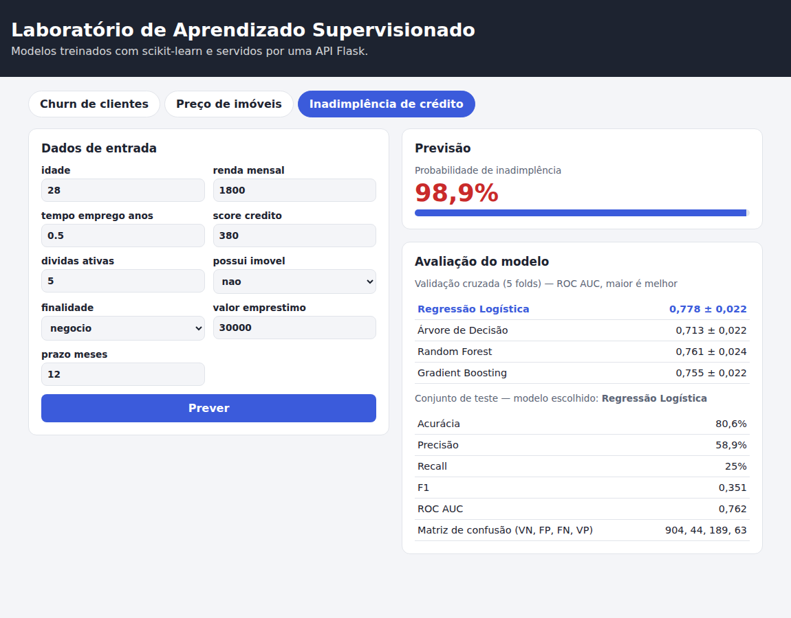
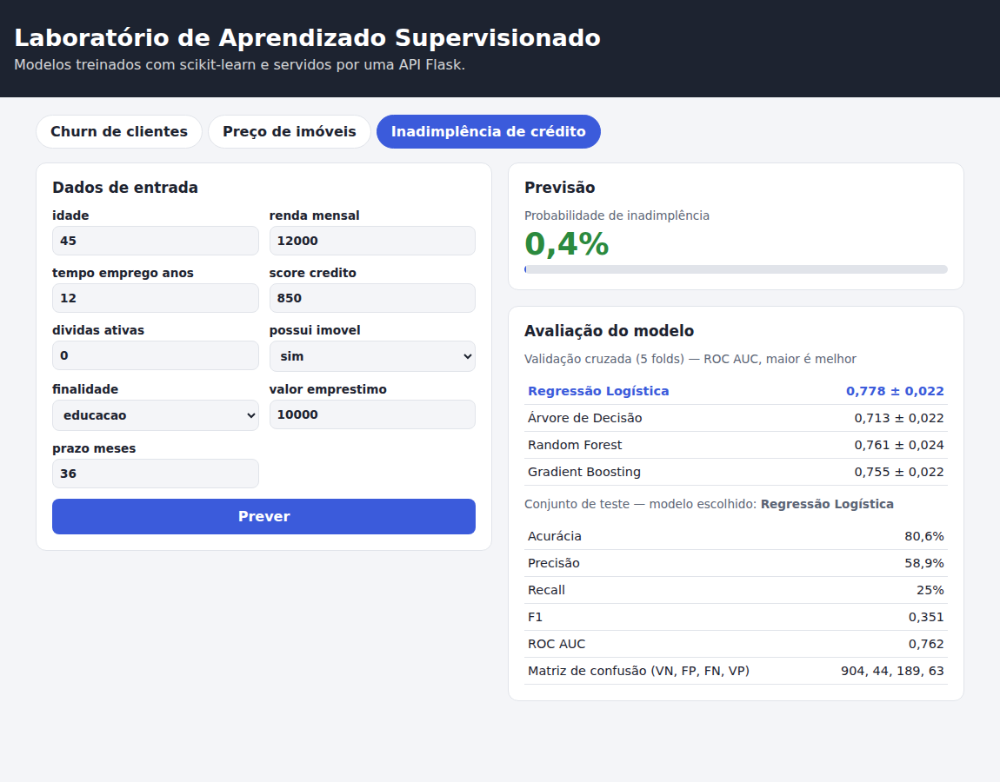
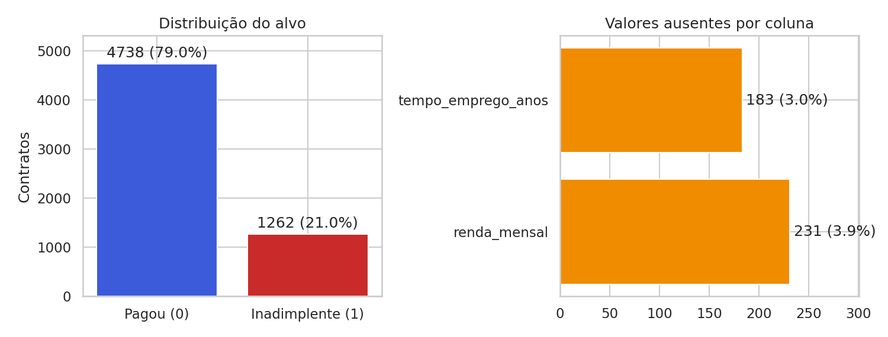
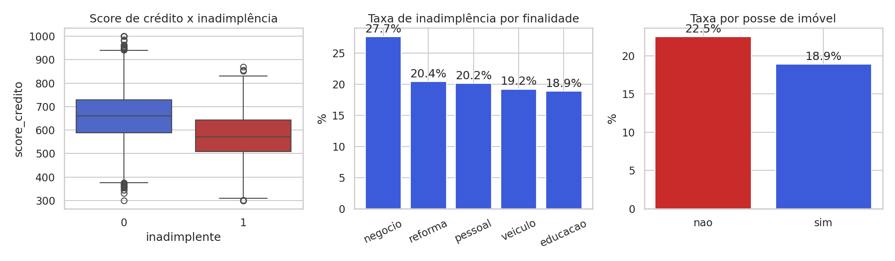
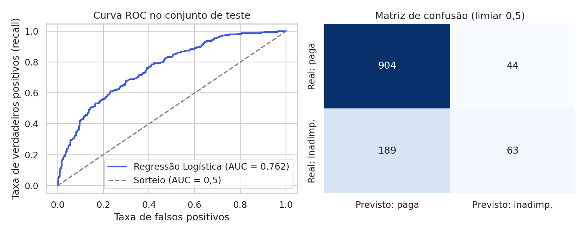
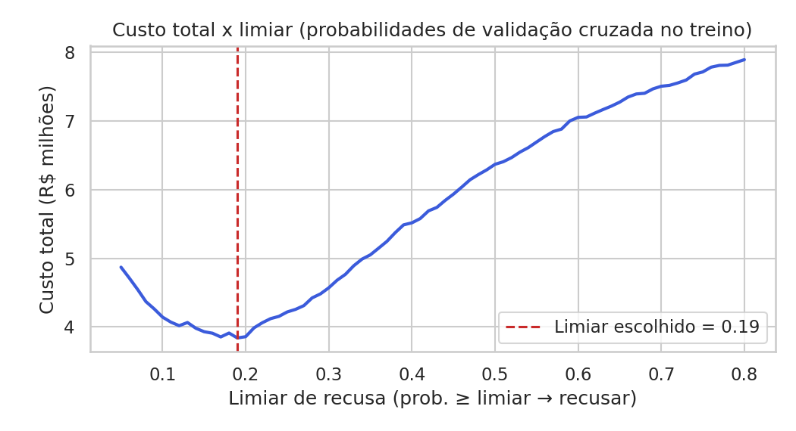

# Laboratório de Aprendizado Supervisionado — Inadimplência de Crédito

**Disciplina:** Inteligência Artificial e Machine Learning · **Atividade Prática 2** (Aula IAML 05)
**Professor:** Hercules Ramos · **FMU**

## Integrantes do grupo

| # | Nome completo | RA |
|---|---------------|----|
| 1 | _preencher_ | _preencher_ |
| 2 | _preencher_ | _preencher_ |
| 3 | _preencher_ | _preencher_ |
| 4 | _preencher_ | _preencher_ |
| 5 | _(opcional)_ | |
| 6 | _(opcional)_ | |

---

## 1. Visão geral

Uma fintech quer estimar a **probabilidade de inadimplência** de pedidos de empréstimo para apoiar a equipe de crédito. Construímos um sistema completo de aprendizado supervisionado: exploração dos dados, pipeline sem vazamento, comparação de algoritmos por validação cruzada, avaliação orientada a custo de negócio, API Flask e interface web.

O projeto estende o "laboratório" da aula (churn e preço de imóveis) com um terceiro problema, `credito`. Os dados são **sintéticos** (gerados por `gerar_dados.py`, semente 42), sem dados pessoais reais.

Relatório completo com gráficos e análises: [`docs/relatorio_exercicio_credito.pdf`](docs/relatorio_exercicio_credito.pdf).

## 2. Estrutura do repositório

```
laboratorio-ml/
├── README.md
├── requirements.txt
├── config.py              # problemas, features e limites (inclui o problema "credito")
├── gerar_dados.py         # gera data/churn.csv, imoveis.csv e credito.csv
├── treinar.py             # compara algoritmos, avalia no teste e salva em models/
├── analise_credito.py     # exercício: Partes 1 a 4 e bônus (gera figuras/ e resultados_credito.json)
├── gerar_relatorio.py     # monta o relatório PDF
├── app.py                 # API Flask
├── templates/index.html   # interface web
├── data/                  # CSVs gerados
├── figuras/               # gráficos e capturas de tela
├── docs/                  # relatório em PDF
└── resultados_credito.json
```

## 3. Como executar

Requer Python 3.11 ou superior.

```bash
python -m venv .venv
source .venv/bin/activate            # Windows: .venv\Scripts\Activate.ps1
pip install -r requirements.txt matplotlib seaborn
python gerar_dados.py                # gera os CSVs em data/
python treinar.py                    # treina os 3 modelos e salva em models/
python analise_credito.py            # análise do exercício (figuras/ + resultados_credito.json)
python app.py                        # abre http://localhost:5000
```

> A versão do scikit-learn é fixada em 1.9.1 no `requirements.txt` porque um modelo salvo só é compatível com a versão que o gerou. Nossos resultados foram gerados com scikit-learn 1.8.0; com outra versão, pequenas diferenças numéricas são possíveis.

Teste da API pelo terminal:

```bash
curl -X POST http://localhost:5000/api/prever/credito -H "Content-Type: application/json" \
  -d '{"idade":28,"renda_mensal":1800,"tempo_emprego_anos":0.5,"score_credito":380,"dividas_ativas":5,"possui_imovel":"nao","finalidade":"negocio","valor_emprestimo":30000,"prazo_meses":12}'
```

## 4. Dados

`data/credito.csv`: 6.000 contratos, 21,0% inadimplentes (alvo `inadimplente`: 1 = não pagou).

| Coluna | Descrição |
|---|---|
| `id_contrato` | Identificador (**descartado**: não é feature) |
| `idade`, `renda_mensal`, `tempo_emprego_anos` | Dados do cliente (renda e tempo de emprego têm ausentes) |
| `score_credito` | Pontuação de 300 a 1000 |
| `dividas_ativas` | Dívidas em aberto |
| `possui_imovel` | sim ou nao |
| `finalidade` | pessoal, veiculo, reforma, educacao ou negocio |
| `valor_emprestimo`, `prazo_meses` | Valor em R$ e prazo (12 a 60 meses) |
| `inadimplente` | **Alvo** |

## 5. Metodologia

- **Divisão:** 80/20, estratificada, `random_state=42` (4.800 treino / 1.200 teste).
- **Pipeline sem vazamento:** `ColumnTransformer` com imputação por mediana + `StandardScaler` nas numéricas e imputação pela moda + `OneHotEncoder(handle_unknown="ignore")` nas categóricas, encadeado ao algoritmo. As transformações são aprendidas só com o treino de cada fold.
- **Comparação:** validação cruzada de 5 folds, métrica ROC AUC.
- **Teste:** usado uma única vez, com o modelo já escolhido.
- **Limiar:** escolhido com probabilidades de `cross_val_predict` no treino, minimizando o custo (R$ 8.000 por inadimplente aprovado + R$ 1.500 por bom cliente recusado).

## 6. Resultados

**Validação cruzada (ROC AUC, média ± desvio)**

| Algoritmo | ROC AUC |
|---|---|
| **Regressão Logística** | **0,7781 ± 0,0224** |
| Random Forest | 0,7613 ± 0,0235 |
| Gradient Boosting | 0,7547 ± 0,0217 |
| Árvore de Decisão | 0,7126 ± 0,0216 |

**Teste (modelo: Regressão Logística, limiar 0,5):** acurácia 80,6% · precisão 58,9% · recall 25,0% · F1 0,351 · ROC AUC 0,762 · matriz de confusão (VN, FP, FN, VP) = 904, 44, 189, 63.

**Limiar recomendado: 0,19.** Custo no teste: **R$ 1.075.000** (71 FN, 338 FP; precisão 34,9%, recall 71,8%), contra R$ 1.578.000 com o limiar 0,5, R$ 2.016.000 aprovando todos e R$ 1.422.000 recusando todos.

**Interpretação.** O falso negativo (inadimplente aprovado) custa cerca de 5,3 vezes mais que o falso positivo (bom cliente recusado), por isso o limiar ótimo fica bem abaixo de 0,5. Teoricamente, com probabilidades calibradas, recusar compensa quando p > 1.500/9.500 ≈ 0,158; o valor empírico (0,19) é consistente.

**Bônus.** A feature "comprometimento de renda" e o `GridSearchCV` não trouxeram ganho confiável de ROC AUC (diferenças dentro do desvio entre folds). O `class_weight="balanced"` troca precisão por recall (recall 26,6% → 68,7%; precisão 59,8% → 38,0%) sem mudar o ROC AUC.

### Capturas da aplicação (nova aba "Inadimplência de crédito")

Risco alto (98,9%):



Risco baixo (0,4%):



### Gráficos






## 7. Integração ao sistema

O problema `credito` foi adicionado ao dicionário `PROBLEMAS` em `config.py` (nove features, limites e opções). Como `treinar.py`, `app.py` e `index.html` leem tudo de `config.py`, a nova aba, o formulário e a validação de entrada da API funcionam sem alterações nesses arquivos.

## 8. Ética e LGPD

Modelos de crédito podem reproduzir discriminação histórica, inclusive via _proxies_ (CEP/bairro, idade). Não usamos gênero, raça/cor, religião, orientação sexual, estado civil, nome, dados de saúde nem CEP/bairro; a idade, presente no dataset, deveria ser auditada antes de produção. Adotamos um modelo interpretável (regressão logística), e a decisão final deve ter humano no circuito. Pela LGPD, o tratamento exige finalidade e base legal (art. 7º, X: proteção do crédito), minimização de dados (art. 6º) e garante ao titular a revisão de decisões automatizadas (art. 20). Detalhes no relatório.

## 9. Divisão de tarefas

| Integrante | Contribuição |
|---|---|
| _preencher_ | _preencher_ |

## 10. Referências

Material da Aula IAML 05 (Prática 2), Prof. Hercules Ramos; documentação do scikit-learn; Lei nº 13.709/2018 (LGPD).
